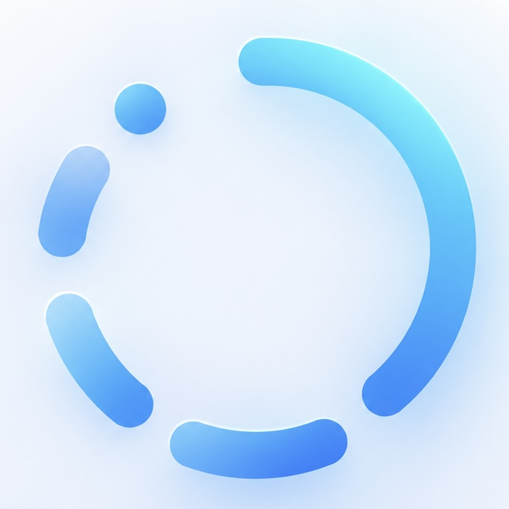
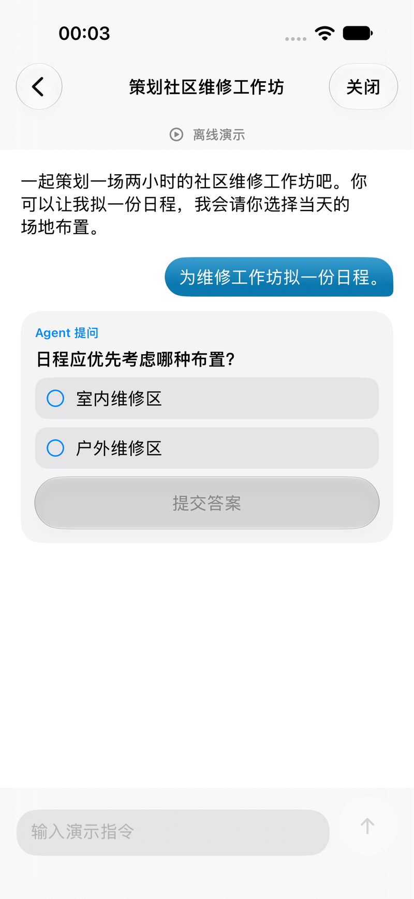
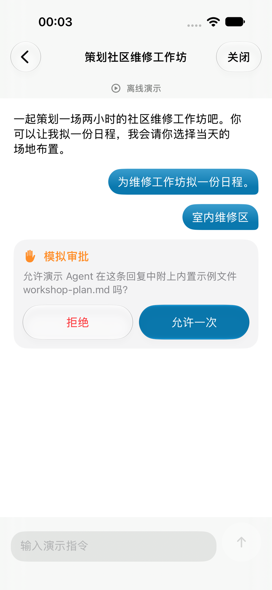
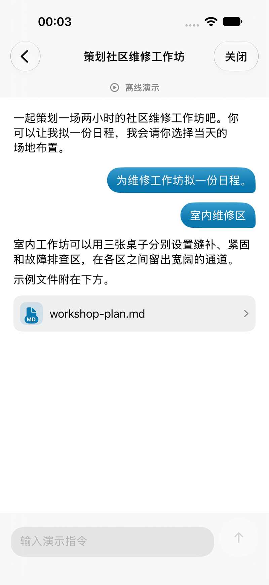
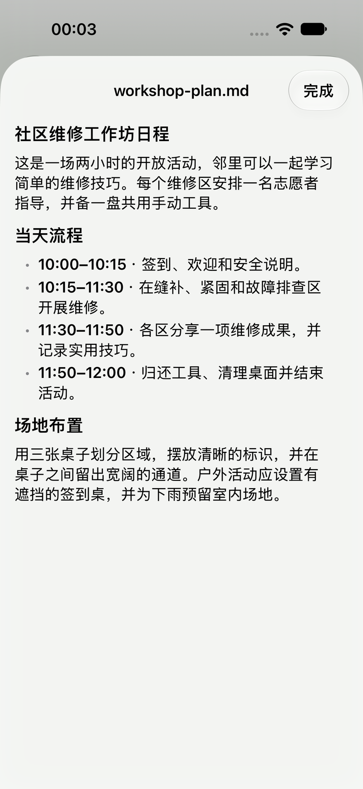
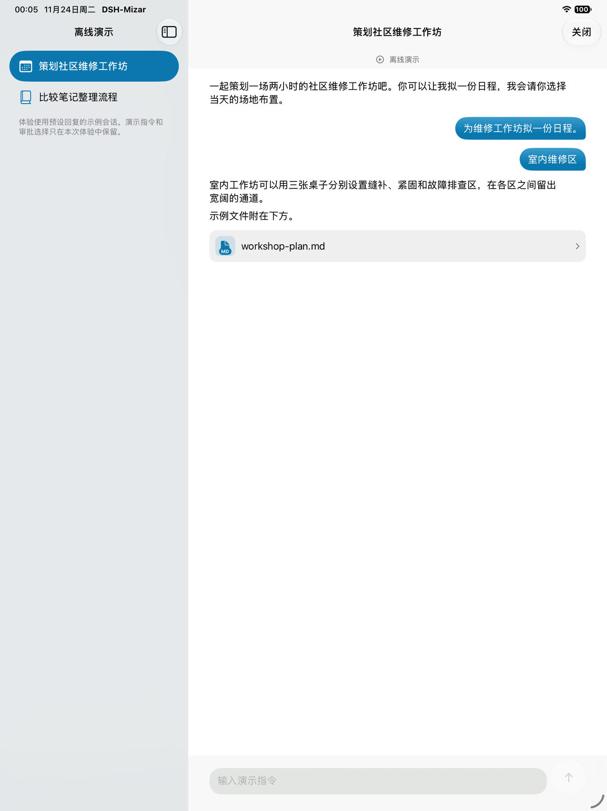
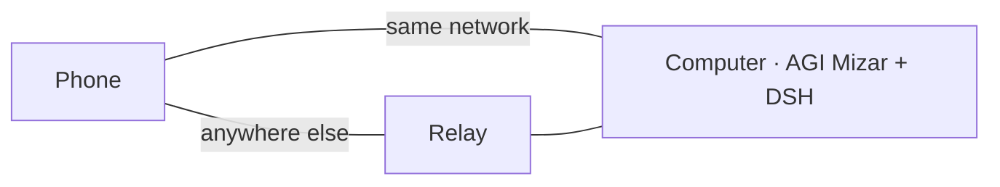

<div align="center">

<picture>
  <source media="(prefers-color-scheme: dark)" srcset="DSH-Mizar/Assets.xcassets/AppIcon.appiconset/AppIcon-1024-dark.png">
  
</picture>

# DSH-Mizar

**The DSH agent that runs on your computer, in your pocket: watch it work, talk to it, say yes for it.**

Sessions, approvals and Lock Screen progress live on the phone. The computer keeps working.

<p>
  
  
  
  <a href="LICENSE"></a>
  <a href="https://github.com/ShirazuNagisa/DSH-Mizar-iOS/stargazers"></a>
</p>

[Before you start](#start) · [Pair in three steps](#pair) · [What it does](#features) · [Transport](#link) · [Lock Screen](#lock) · [Local agent](#local) · [Account](#account) · [Privacy](#privacy) · [Development](#dev) · [Licence](#license)

<sub>[中文](README.md)</sub>

</div>

<table>
  <tr>
    <td align="center"></td>
    <td align="center"></td>
    <td align="center"></td>
  </tr>
  <tr>
    <td align="center"><sub>It asks first</sub></td>
    <td align="center"><sub>You make the call</sub></td>
    <td align="center"><sub>Then the file lands</sub></td>
  </tr>
</table>

<p align="center"><sub>Shot inside the built-in offline demo: no computer, no account, the same walkthrough.</sub></p>

<br>

<a id="start"></a>

## Before you start

**The phone is a remote control, not the machine.** The DSH that does the work runs on your computer; the phone watches, talks and decides.

- **Computer**: macOS or Windows. Install the [AGI Mizar](https://github.com/ShirazuNagisa/AGI-Mizar) desktop app first, then the `dsh-mizar` plugin, then restart DSH.
- **Phone**: an iPhone or iPad on iOS / iPadOS 26 or later (the interface uses Liquid Glass).
- **The app ships through TestFlight for now**: [testflight.apple.com/join/MyaqdT1z](https://testflight.apple.com/join/MyaqdT1z). The desktop app's onboarding shows the same link.

Want to build it yourself? Jump to [Development](#dev).

<a id="pair"></a>

## Pair in three steps

1. Open the pairing panel in AGI Mizar on the computer.
2. Scan the QR code it shows — or type the pairing code next to it.
3. Open the app and go.

**That's all.** No token, no address, no config file.

On first launch the app asks for notifications and local-network access; **the camera is only requested the moment you tap "Scan"** — asking at launch for something most sessions never use just teaches people to tap "Don't allow" without reading.

<a id="features"></a>

## What it does

<table>
  <tr>
    <td align="center" width="33%"><b>Watch</b><br><sub>Sessions grouped by workspace.<br>The running one carries a twin star;<br>the one waiting on you, an orange hand.</sub></td>
    <td align="center" width="33%"><b>Talk</b><br><sub>Send messages, interrupt a turn.<br>Rewrite a draft, dictate it,<br>or search the computer's commands and skills.</sub></td>
    <td align="center" width="33%"><b>Decide</b><br><sub>Approvals and questions dock above<br>the composer, one card at a time —<br>and on the Lock Screen too.</sub></td>
  </tr>
</table>

**One summary per turn.** Each turn ends with "**Finished, took mm:ss**"; the running one reads "**DeepSeeking, mm:ss**". Neither line expands: the step-by-step narration and tool calls never reach the phone at all — they are most of the relay traffic, so they stay behind. The newest summary types itself out, the way the desktop does it; older history and pull-to-refresh render immediately, and Reduce Motion skips the typing.

**Things you can send while a turn is running — queued or injected.** By default they queue: the text waits in a bar above the composer and goes out when the turn ends, with three buttons — send now as guidance, put it back in the composer, delete it. Turn on Settings → Sending → guide by default and the same text is injected into the running turn immediately. Want it stopped? Interrupt it.

**What could not be read is never erased.** Titles, model and context usage come from separate host projections; a failed read leaves what is on screen alone — that is exactly how "open a session and the title and usage vanish" used to happen. A whole-page failure keeps the last content and offers a refresh button in the corner.

**Also on the phone:**

- **Delivered files**: Markdown, PDF, Word, PNG/JPG, and common source code (C/C++/Java/Python/Swift/Kotlin/HTML/CSS/JS/TS/JSON/XML). Read-only, selectable, first 1 MB only.
- **Attachments**: photos and files go over the same WebSocket in 128 KiB chunks; photos are downscaled and re-encoded first; anything over the limit is refused on the phone, not after the upload.
- **History lives on the phone**: sessions, titles, model and usage are readable offline.
- **On iPad it is two panes**: sessions and sidebar on the left, conversation and turn index on the right; collapsed, the index becomes a ruler you can drag.

<table>
  <tr>
    <td align="center"></td>
    <td align="center"></td>
  </tr>
  <tr>
    <td align="center"><sub>Delivered files open on the phone</sub></td>
    <td align="center"><sub>Two panes on iPad</sub></td>
  </tr>
</table>

<details>
<summary><b>The rest of the interface</b></summary>

<br>

- **Sidebar** (swipe right in a conversation, or tap the top-left button): the computer's name, refresh and search pinned at the top, a connection bar under the name, sessions grouped by workspace with the open one expanded. Long-press a session row to copy its id or archive it — archiving is done by the computer, and a running session is refused with the reason shown above the list.
- **Turn index** (swipe left, or tap the title): one row per turn, like the desktop's turn list. Turns on screen are lit on the timeline, and the thin line under each row is how long that turn took.
- **The right drawer has three tabs**: turns, subagents, preview. The first two carry the current count; preview lists the files the model delivered.
- **Connection panel** (tap the pill at the bottom): transport and address, uptime, a live latency curve, and what polling is doing right now. Latency is only measured while the panel is open.
- **Everything that pops out grows from the button you pressed** — model, context, commands, permissions, new session, refresh progress, settings, switch computer, pairing (the camera opens inside it too). The system share sheet is the only exception.
- **Settings is a directory**: account at the top, then notifications and Live Activities, sending, transport, local agent, local files and cache, community, logs, about. Each row explains itself.
- **One switch for all haptics.** With Reduce Motion on, every animation becomes a cross-fade; state still changes, nothing moves.
- **In-app announcements** pushed from the server, with an optional button that opens a settings page; each device sees a given announcement once. **Questionnaires** (Settings → About) pay their reward — 7 days by default — as soon as the server confirms.

</details>

<a id="link"></a>

## Transport



The relay is the fallback for "not on the same network", not the first choice. Whether the app looks for the LAN on reconnect is a setting — **Settings → Transport → LAN first**, off by default. Off, it skips the scan and reconnects over the saved route. On, it scans on manual refresh and when the app returns to the foreground, and switches to a direct socket when one answers. An address must report **the same host id** before the app will use it, so some other DSH server on the same Wi-Fi is never mistaken for your computer.

**The relay can be self-hosted.** First-run setup and Settings → Transport both take your own server address; [DSH-Mizar-Relay](https://github.com/ShirazuNagisa/DSH-Mizar-Relay) is the same server.

Three things differ on a LAN connection:

- the sidebar says "LAN", and the connection panel shows no relay domain;
- polling a running turn goes from 10 s to **3 s**;
- **attachments and the full turn detail stop requiring a paid account** — they are the only parts of the paid plan that cost relay bandwidth.

**When it cannot connect, it says which hop broke.** The bar under the computer's name draws the phone and the computer as dots, with the relay in between when there is one; whichever segment failed gets a red cross:

| Where the cross is | What it means |
|---|---|
| Left of the relay | The phone cannot reach the relay: no network, DNS, timeout, refused, 5xx |
| Right of the relay | The relay answered but your computer is not there (`404` — the status code, not the message text) |
| Dead centre, direct | There is no middle hop on LAN, tailnet or P2P; the line broke where it broke |
| Left of the computer | Both hops are up and the computer refused this phone (auth failure, revoked device) |

When connected there is no cross and the dots pulse left to right. With both routes failed, the cross is drawn on the route that **explains the most** — a relay `404` beats a LAN timeout.

<a id="lock"></a>

## Lock Screen and Dynamic Island

While a session runs, the Lock Screen and Dynamic Island show it; the clock on the right is the system's own timer text, so the app does not refresh every second. **Sessions on several computers can be up there at once**, and tapping a card opens exactly that session; approvals can be answered from the Lock Screen.

When a turn ends the card puts itself away: the app does it while awake, and when the app is asleep in a pocket the phone hands the card's push token to the computer, which ends it with a server push — so the clock never keeps running for a session that ended long ago.

**One honest limitation**: an activity never appears on its own if the app has not been opened. iOS only lets an app *start* an activity in the foreground; background work can only update or end one that exists. Push-to-start would fix it (a different token) and is not in this version yet, so a brand-new session reaches the Lock Screen after you open the app once.

<a id="local"></a>

## Local agent (experimental)

With no computer around, the phone can host the agent itself: the kernel is the same TypeScript (`LocalKernel/`), running in JavaScriptCore, speaking the same byte-for-byte Mizar protocol v1 — so sessions, approvals and turns look exactly the same.

- **Where**: the top-left page is "Agent", and its first row is "Local agent (experimental)".
- **Models**: Settings → Local agent → add a provider with an API address and key, then "Test connection" asks `GET <address>/models`: success lists the models to pick from; 401/403 means the key, 404/405 means the address, a timeout means it is unreachable. The key lives in the phone's Keychain.
- **Foreground only.** Leaving the app or locking the phone stops it: iOS suspends the whole process and the kernel inside it freezes. A turn interrupted that way is recorded as stopped; the history stays.
- **A workspace is a folder**: everything lives under `Documents/LocalAgent/`, one folder per workspace, visible in the Files app (On My iPhone → DSH-Mizar → LocalAgent). Files the agent writes land there.
- **Not supported yet** (hidden rather than offered and then failing): attachments, delivered-file previews, forked sessions, subagents, Live Activities, the DeepSeek balance.

<a id="account"></a>

## Account and subscription

**The account is optional.** Signed out, everything free still works: pairing, sessions, conversation, approvals, Live Activities, push. Nothing asks you to sign in at launch; the account only exists in Settings.

- **Paid** comes from either an auto-renewing App Store subscription (¥6/month, price read from `product.displayPrice`) or a code granted by an admin; the later expiry wins. Restore and manage-subscription links are right there.
- **Sign in with Apple** returns no avatar (Apple has no public API for it), so the default is a generated initial; you can pick a photo, kept on this device only.
- **Invite codes**: account page → redeem, and the time is added to the current expiry.
- **Relay quota**: 500 MiB a day on a free account, 5 GiB paid; signed-out requests are refused. Attachments and full turn detail need either a paid account or a LAN connection.
- **An unreachable account server does not break the free features**: the account page keeps its cached profile and says it cannot connect, instead of pretending you signed out.
- Email accounts are limited to two devices; the app lists them and can sign out or delete the account.

<a id="privacy"></a>

## Privacy

- **Account**: email, username and password hash (or the Sign in with Apple subject) on the account server `dshmizar-1.shirazu-nagisa.com`; passwords are stored only as a scrypt hash.
- **Avatar**: the email's MD5 may be sent to a Gravatar mirror to fetch a public avatar; falling back to generated initials.
- **Devices**: install id, device model and app version, used for the device list and the two-device limit.
- **Subscription**: the App Store transaction is verified by the relay to set the paid expiry; the app never sees a payment method and never stores a receipt.
- **Traffic**: the relay counts bytes per account-token hash, per install and per anonymous hash for 90 days, for quotas and the admin traffic table.
- **Conversations and attachments never reach the account server.** They travel between the phone and your computer over the paired connection; the relay forwards WebSocket frames and stores nothing.
- No analytics SDK, no advertising SDK, no third-party tracking. Photo-library permission is **deliberately not requested** (`PhotosPicker` only reads what you pick), and there is no `NSPhotoLibraryUsageDescription` in the Info.plist.

Full text: [Privacy policy](https://dsh-mizar.shirazu-nagisa.com/privacy/) · [Terms](https://dsh-mizar.shirazu-nagisa.com/terms/)

<a id="repos"></a>

## Related repositories

| | |
|---|---|
| [AGI Mizar](https://github.com/ShirazuNagisa/AGI-Mizar) | The computer-side host: pairing, relay tunnel, push, protocol. **Install this first** |
| [DSH-Mizar](https://github.com/ShirazuNagisa/DSH-Mizar) | The DSH plugin that attaches a DSH process to AGI Mizar |
| [DSH-Mizar-Relay](https://github.com/ShirazuNagisa/DSH-Mizar-Relay) | The relay server, also good for self-hosting |
| [Mizarllm](https://github.com/ShirazuNagisa/Mizarllm) | The judge model that decides whether a round is done (optional) |
| This repository | The iOS / iPadOS app |

<a id="dev"></a>

<details>
<summary><b>Development</b></summary>

<br>

Xcode 26 or later, and `iOS 26` as the floor (the interface uses Liquid Glass).

```sh
git clone git@github.com:ShirazuNagisa/DSH-Mizar-iOS.git
cd DSH-Mizar-iOS
npm install                      # only `ws`, for the mock host; the app has no dependencies
scripts/ios.sh run               # build and install into the simulator
```

For a device, open `DSH-Mizar.xcodeproj`, pick your team in Signing & Capabilities. Push needs the **Push Notifications** capability on the App ID — see [`docs/testflight.md`](docs/testflight.md).

**Tests**

```sh
scripts/swift.sh test            # the whole MizarKit (protocol) suite, on the Mac, seconds
scripts/test-select.sh           # run what the diff can prove is affected
scripts/test-select.sh --dry-run # print the selection and the reasons, run nothing
scripts/ios.sh test-fast "iPhone 18 Pro" -only-testing:DSH-MizarUITests/AppFlowTests
```

- `test-select.sh` runs the replay layer by default: no real host, no real model. `--live` opts into the network layer.
- Anything it cannot prove is local falls back to the whole UI suite. That is the zero-miss default, not a bug.
- The snapshot suite (`DSH-Mizar-Snapshots`) renders leaf views with `ImageRenderer` and compares reference PNGs — sub-second. It records only with `MIZAR_SNAPSHOT_RECORD=1`; see [`docs/snapshots.md`](docs/snapshots.md).
- UI tests need the mock host; `test` and `test-fast` start it on 19395/19396 and shut it down afterwards. Never run two `xcodebuild test` at once — they fight over the simulator.

**The screenshots in this README** come from the offline demo, so they need neither a host nor an account:

```sh
TEST_RUNNER_MIZAR_APPSTORE_SHOTS=/tmp/shots scripts/ios.sh test "iPhone 18 Pro" \
  -only-testing:DSH-MizarUITests/AppStoreShotsTour/testPhone
# iPad: same command with "iPad Pro 13-inch (M5)" and testPad
```

**Packaging**

```sh
scripts/release.sh export       # → ../../release/iOS/DSH-Mizar-<version>.ipa
scripts/release.sh upload       # to App Store Connect (TestFlight)
```

Signing needs a paid Apple Developer account (`MIZAR_TEAM_ID` overrides the team id); details in [`docs/testflight.md`](docs/testflight.md).

**Layout**

| | |
|---|---|
| `DSH-Mizar/` | The app: views, AppModel, permissions, push |
| `MizarKit/` | The protocol layer: connection, frames, session model, cache. `swift test` runs this |
| `LocalKernel/` | The local agent's TypeScript kernel, running in JavaScriptCore |
| `DSH-Mizar-LiveActivity/` | The widget extension: Dynamic Island and Lock Screen |
| `DSH-MizarTests/` | Snapshot tests (layout and copy, no app launch) |
| `DSH-MizarUITests/` | XCUITest, against `scripts/mock-host.mjs` |
| `protocol/fixtures/` | Golden frames recorded from a real host, shared with the desktop |
| `media/` | The screenshots this README uses |
| `scripts/` | Build, test, mock host, screenshots, packaging |

**CI** ([`.github/workflows/ci.yml`](.github/workflows/ci.yml)) runs the kernel check, the unit suite and the snapshots on every pull request; the UI suite runs only when the PR carries the `ui` label. The local equivalent is `scripts/pre-merge.sh`.

The protocol itself lives in the desktop repository: [`docs/protocol-v1.md`](https://github.com/ShirazuNagisa/AGI-Mizar/blob/main/docs/protocol-v1.md).

</details>

<a id="license"></a>

## Licence

Released under the **GNU General Public License v3.0** (GPLv3, SPDX: `GPL-3.0-only`); the full text is in [LICENSE](LICENSE).

There is also an **App Store additional permission** under section 7 of the GPLv3: it allows conveying this program and works based on it through the Apple App Store or TestFlight, resolving the conflict between the GPLv3 and the store's terms, DRM and the section 6 "Installation Information" requirement. The complete corresponding source must still be available under the GPLv3. Full text: [LICENSE-EXCEPTION](LICENSE-EXCEPTION).
