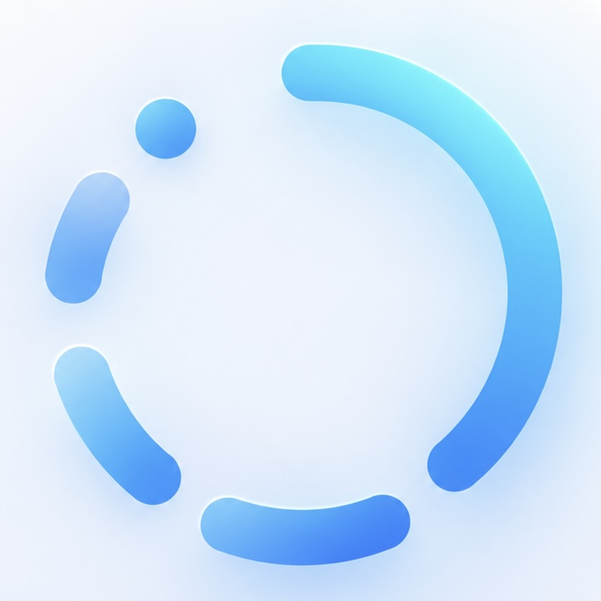
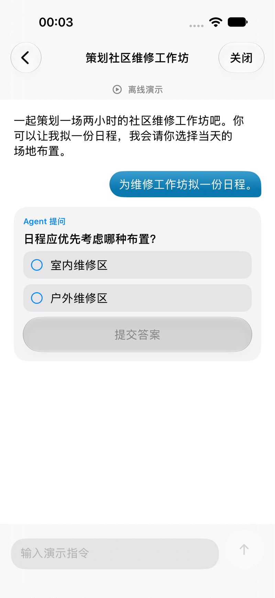
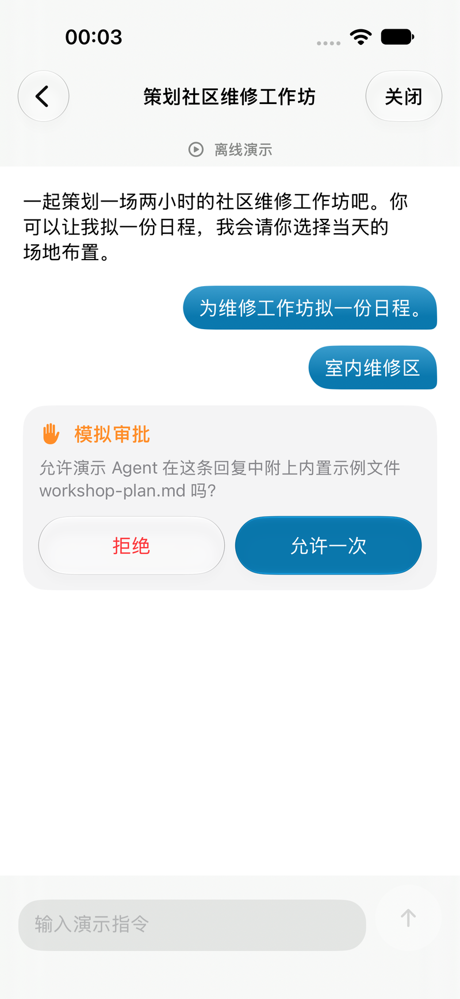
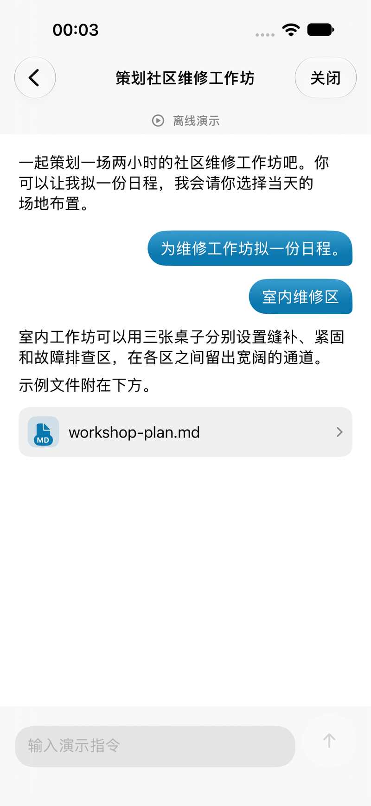
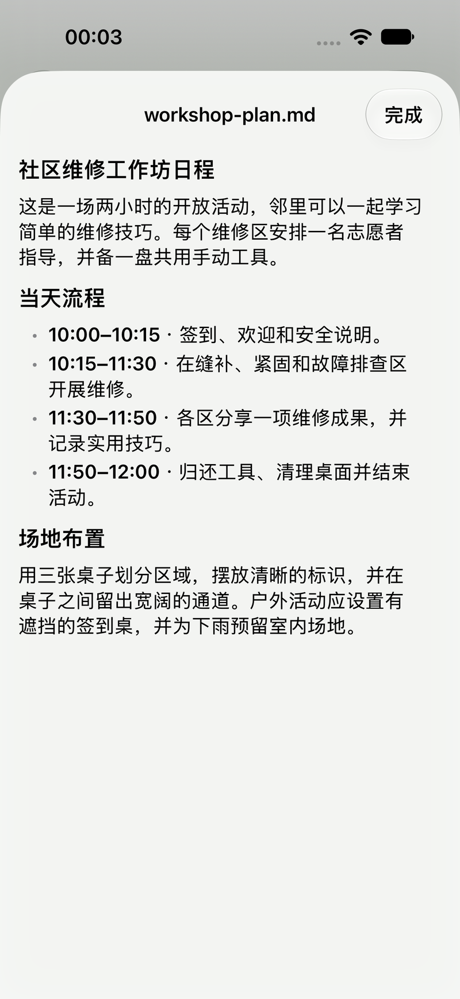
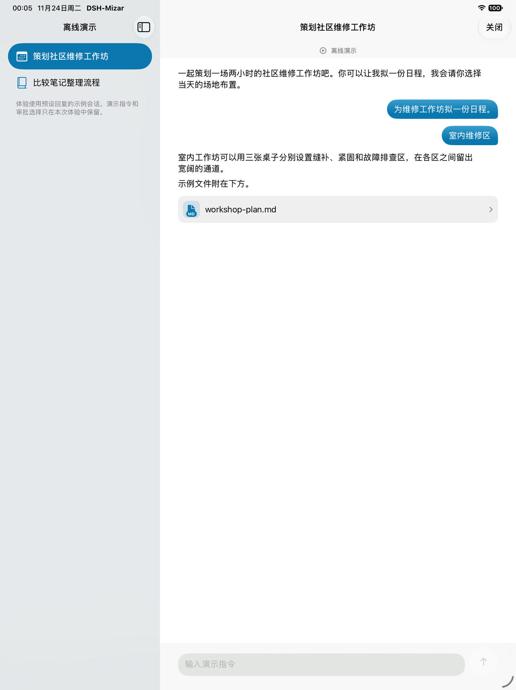
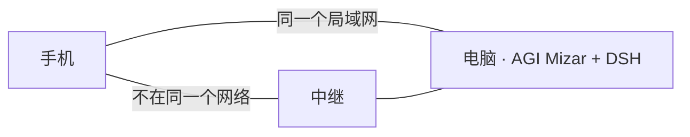

<div align="center">

<picture>
  <source media="(prefers-color-scheme: dark)" srcset="DSH-Mizar/Assets.xcassets/AppIcon.appiconset/AppIcon-1024-dark.png">
  
</picture>

# DSH-Mizar

**把电脑上干活的 DSH Agent 揣进兜里：看它做、给它发话、替它点「允许」。**

会话、审批和锁屏上的进度都在手机上；电脑照常干活。

<p>
  
  
  
  <a href="LICENSE"></a>
  <a href="https://github.com/ShirazuNagisa/DSH-Mizar-iOS/stargazers"></a>
</p>

[开始之前](#start) · [三步连上](#pair) · [能干什么](#features) · [连接](#link) · [锁屏和灵动岛](#lock) · [本地 Agent](#local) · [账户](#account) · [隐私](#privacy) · [开发](#dev) · [许可](#license)

<sub>[English](README.en.md)</sub>

</div>

<table>
  <tr>
    <td align="center"></td>
    <td align="center"></td>
    <td align="center"></td>
  </tr>
  <tr>
    <td align="center"><sub>它先问你</sub></td>
    <td align="center"><sub>你替它拍板</sub></td>
    <td align="center"><sub>答完，文件在下面</sub></td>
  </tr>
</table>

<p align="center"><sub>以上摄于内置的离线演示：没有电脑、没有账号，装好也能把这几步走一遍。</sub></p>

<br>

<a id="start"></a>

## 开始之前

**手机是遥控器，不是本体。** 真正干活的是你电脑上的 DSH，手机负责看、说话、拍板。

- **电脑**：macOS 或 Windows，先装 [AGI Mizar](https://github.com/ShirazuNagisa/AGI-Mizar) 桌面端，再装 `dsh-mizar` 插件并重启 DSH。
- **手机**：iOS / iPadOS 26 及以上的 iPhone 或 iPad（界面用的是 Liquid Glass）。
- **手机端目前走 TestFlight 定向内测**：[testflight.apple.com/join/MyaqdT1z](https://testflight.apple.com/join/MyaqdT1z)。桌面端新手引导里也是这个链接，两边一致。

想自己编译、或者想改点东西？跳到 [开发](#dev)。

<a id="pair"></a>

## 三步连上

1. 电脑上打开 AGI Mizar 的配对面板。
2. 面板上出现二维码，旁边还有一串配对码。
3. 手机打开 App，扫码（或者把配对码敲进去）。

**就这些。** 不用填 token、不用填地址、不用改文件。

第一次打开只会问通知和本地网络这两个权限；**相机权限只在你点「扫码」的那一刻才问** —— 一个大部分会话都用不上的权限，启动时就问，等于在教人闭着眼睛点「不允许」。

<a id="features"></a>

## 能干什么

<table>
  <tr>
    <td align="center" width="33%"><b>看</b><br><sub>会话按工作区分组，<br>正在跑的那一轮标着双星，<br>等你审批的标着一只橙色的手。</sub></td>
    <td align="center" width="33%"><b>说</b><br><sub>打字发消息，中途能打断。<br>输入框里能改写草稿、用语音说，<br>也能搜电脑上的命令和技能。</sub></td>
    <td align="center" width="33%"><b>拍板</b><br><sub>审批和提问停在输入框上方，<br>一次一张，<br>锁屏上也能直接答。</sub></td>
  </tr>
</table>

**一轮只回一趟总结。** 每轮结尾是「**已完成，用时 xx 分 xx 秒**」，正在跑的那一轮是「**深度求索中，用时 xx 分 xx 秒**」，两行都点不开 —— 逐条叙述和工具调用根本不会传到手机上（省的是带宽，中继流量主要就花在这块）。新到的那条总结会像桌面端一样逐字打出来；翻历史、下拉刷新带出的旧内容直接显示，不重播；开了「减弱动态效果」也直接显示。

**回合进行中说的话，可以等，也可以插。** 默认是等：文字停输入框上方一条长条里，本轮结束后自动发出，右侧三个键分别是「立即作为引导发送」「退回输入框」「删除」。打开「设置 → 消息发送偏好 → 默认引导发送」后，同样的文字会当场作为引导插进正在跑的那一轮。想停掉正在跑的回合，直接打断。

**读不到的东西不会被抹掉。** 标题、模型、上下文用量来自主机各自的 projection，读失败也不会把屏幕上已经画出来的东西清掉 —— 那正是「刚点进去，标题和用量全部消失」的来路。整页读失败时保留上次的内容，并在右上角给一个刷新按钮。

**别的都在手机上：**

- **交付文件预览**：Markdown、PDF、Word，PNG/JPG，以及常见源代码（C/C++/Java/Python/Swift/Kotlin/HTML/CSS/JS/TS/JSON/XML）。源码只读、可选中，最多显示前 1 MB。
- **附件**：照片和文件走同一条 WebSocket 分块上传（128 KiB 一块），照片先缩放再重编码；超限在你本机就告诉你是哪一条，不会先上传再被拒绝。
- **历史存在手机上**：断网也能翻会话、标题、模型和上下文用量。
- **iPad 是分开的两栏**：左边会话和侧边栏，右边对话、轮次索引一列；收起索引时变成会话右侧的一排刻度，按住上下滑就能快速定位。

<table>
  <tr>
    <td align="center"></td>
    <td align="center"></td>
  </tr>
  <tr>
    <td align="center"><sub>交付的文件直接在手机上看</sub></td>
    <td align="center"><sub>iPad 上分成两栏</sub></td>
  </tr>
</table>

<details>
<summary><b>界面上还有这些</b></summary>

<br>

- **侧边栏**（聊天页往右滑，或点左上角）：顶部固定着电脑的名字、刷新和搜索框；名字下面是一个连接状态条；列表按工作区分组，正在打开的会话所在工作区会自己展开。会话行可以长按，菜单里是「复制会话 ID」和「归档该会话」——归档由电脑端执行，正在跑的会话不会被静默打断，电脑会拒绝并把原因显示在列表上方。
- **轮次索引**（聊天页往左滑，或点标题）：一轮一行，像桌面端的轮次列表。屏幕上正在显示的那几轮在时间线上被点亮，每行下面一条细线就是这一轮花的时间；点一行就跳过去。
- **右侧抽屉的三段开关**：「轮次」「子代理」「预览」。轮次和子代理后面带当前会话的个数；预览页显示模型交付的文件。
- **连接小窗**（点底部的连接胶囊）：连接方式和地址、连上多久、实时测出来的延迟曲线，以及自动轮询在做什么。只在小窗打开时才测延迟。
- **所有弹出的东西都是从按钮里长出来的小窗**，不是占满屏幕的大窗口。唯一的例外是系统自己的分享面板。
- **设置是一个目录**：账户在最上面，下面依次是通知与实时活动、消息发送偏好、传输、本地 Agent、本地文件与缓存、社区、日志、关于与更多，每行带一句说明。
- **触感**一个开关管所有震动；开「减弱动态效果」后所有动画改成原地淡入淡出，状态照样变。
- **应用内公告**：运营可以从服务器给在线设备推一条横幅，可以带一个跳到设置某页的按钮，每台设备同一条只显示一次。**问卷**（设置 → 关于与更多）填完提交，服务器确认后把奖励（默认 7 天）加到账户上。

</details>

<a id="link"></a>

## 连接



中继是「不在同一个网络也能连」的兜底，不是首选。App 会不会在重连时找局域网，由 **设置 → 传输 → 局域网优先** 决定（默认关闭）：关着就直接跳过扫描，重连走已保存的通道；打开后在手动刷新和从后台回前台时先扫一遍局域网，扫到就切直连。每个地址都要**主机 id 对得上**才切 —— 局域网上碰巧有别的 DSH 服务端时不会被当成你的电脑。

**中继可以自建。** 从首次引导到设置里的「传输」，都能填自己的服务器地址；[DSH-Mizar-Relay](https://github.com/ShirazuNagisa/DSH-Mizar-Relay) 是同一套服务端。

走局域网时的三处不同：

- 侧边栏底部写「局域网通信」，连接小窗里不显示中继域名；
- 运行中一轮的自动轮询从 10 秒提到 **3 秒**；
- **附件上传和「全量细节」不再要求付费账户** —— 这两样是付费计划里唯一花中继带宽的东西。

**连不上时，它告诉你是哪一段断了。** 侧边栏顶部那条状态条上，手机和电脑用一排点连起来，走中继时中间多一台服务器；断在哪一段，就在那一段的中间点上一个红叉：

| 叉在哪 | 什么意思 |
|---|---|
| 中继左段 | 手机到不了中继：没有网络、DNS 失败、超时、连接被拒、5xx |
| 中继右段 | 中继答上了，但它那边没有你的电脑（回的是 `404`，读的是状态码不是错误文字） |
| 直连时正中间 | 局域网、tailnet、P2P 都没有中间那一跳，线断在哪里就是哪里 |
| 电脑左边 | 两段都通，是电脑自己拒绝了这台手机（鉴权失败、设备被撤销） |

连上时没有叉，线上的点从左到右轮流胀大缩小，像一波流过去。两条路由都失败时，叉画在**说得最清楚**的那一条上 —— 中继的 `404` 比局域网地址超时更能说明问题。

<a id="lock"></a>

## 锁屏和灵动岛

会话在跑的时候，锁屏和灵动岛会显示它，右边的时钟是系统自己画的计时文本，不靠 App 每秒去刷新。**多台电脑上的会话可以同时在上面**，点一下卡片就进到那一条会话；审批也能在锁屏上直接处理。

会话结束时卡片自己收起来：App 醒着的时候由 App 收；App 在口袋里没醒的时候，手机会把这张卡片的推送令牌交给电脑，电脑用服务端推送把它结束掉 —— 所以锁屏上的时钟不会为一段早就结束的会话继续走。

**一条诚实的限制**：App 一次都没打开过的时候，这个活动不会自己出现。iOS 只允许 App 在前台时新建活动，后台只能更新或结束一个已经存在的；要让它自己出现得靠主机发「启动活动」推送（push-to-start，另一个推送令牌），这一版还没有。所以新开的会话要等你打开一次 App 才会上锁屏。

<a id="local"></a>

## 本地 Agent（实验性）

没有电脑的时候，手机自己当宿主：内核是同一份 TypeScript（`LocalKernel/`），跑在 JavaScriptCore 里，说的是与桌面端**逐字节相同**的 Mizar 协议 v1，所以会话、审批、轮次这些界面一行没改。

- **入口**：左上角那一页叫「Agent 选择」，第一行是「本地 Agent（实验性）」，点它直接进入本地模式。
- **配置模型**：设置 → 本地 Agent →「配置新的模型提供商」，手动填 API 地址和 Key，点「测试连通性」会请求 `GET <地址>/models`：连通就把模型列出来供选择；401/403 说 Key 不对，404/405 说地址不对，超时说连不上。Key 存在这台手机的钥匙串里。
- **只在应用位于前台时工作。** 离开应用或锁屏后本地 Agent 会停止 —— iOS 会挂起整个进程，跑在进程里的内核随之冻结，没人能改这一点。被系统杀掉之后重新进入，上次没跑完的回合会被内核记成「已停止」，历史仍然在。
- **工作区就是文件夹**：根目录在 `Documents/LocalAgent/`，隔一个文件夹就是一个工作区，在「文件」App 里能看到（我的 iPhone → DSH-Mizar → LocalAgent）。Agent 写出的文件直接落进去，可以用文件 App 打开或拷走。
- **这一版不支持的**（界面直接隐藏，而不是给一个点了会失败的按钮）：附件上传、交付文件预览、分支会话、子代理、实时活动、DeepSeek 余额。

<a id="account"></a>

## 账户与订阅

**账户是可选的。** 不登录时免费功能照常：配对、会话、对话、审批、实时活动、推送。启动不会弹登录框，账户只出现在设置里。

- **付费账户**两种来源：App Store 自动续期订阅（¥6/月，价格取自 `product.displayPrice`，不写死）和邀请码 / 管理员授予，付费状态取两者到期时间的较大值。可以恢复购买、跳转管理订阅。
- **Apple 登录**不返回头像（Apple 没有公开这个 API），所以默认是首字母头像；点头像可以从相册选一张，保存在本机，不跨设备同步。
- **邀请码**：账户页 → 兑换邀请码，时长会叠加在现有到期时间上。
- **中继额度**：免费账户每天 500 MiB，付费账户 5 GiB；未登录的请求会被拒绝。附件和「全量细节」要么付费，要么走局域网。
- **账户服务器连不上时免费功能不受影响**：账户页保留缓存的资料并说明连不上，不会把已登录的人显示成未登录。
- 邮箱账户最多绑定两台设备；App 内可以看登录过的设备、退出登录、删除账户。

<a id="privacy"></a>

## 隐私

- **账户**：邮箱、用户名和密码哈希（或 Apple 登录的 subject），存在账户服务器 `dshmizar-1.shirazu-nagisa.com`；密码只以 scrypt 哈希保存。
- **头像**：邮箱的 MD5 可能发给 Gravatar 镜像取公开头像，取不到就用生成的首字母。
- **设备**：安装 id、机型、App 版本，用来显示设备列表、限制邮箱账户的设备数。
- **订阅**：App Store 交易由中继验证后写入付费到期时间；App 看不到支付方式，也不保存收据。
- **流量**：中继按账户 token 哈希、安装、匿名哈希统计字节数，保留 90 天，用于配额和后台流量表。
- **对话和附件从不经过账户服务器**：它们只在手机和你的电脑之间走配对连接，中继只转发 WebSocket 帧，不存内容。
- 没有统计 SDK、没有广告 SDK、没有第三方追踪。相册权限**刻意不申请**（`PhotosPicker` 只读你选中的照片），Info.plist 里也没有 `NSPhotoLibraryUsageDescription`。

完整条款：[隐私政策](https://dsh-mizar.shirazu-nagisa.com/privacy/) · [用户协议](https://dsh-mizar.shirazu-nagisa.com/terms/)

<a id="repos"></a>

## 相关仓库

| | |
|---|---|
| [AGI Mizar](https://github.com/ShirazuNagisa/AGI-Mizar) | 电脑侧宿主：配对、中继隧道、推送、协议。**先装它** |
| [DSH-Mizar](https://github.com/ShirazuNagisa/DSH-Mizar) | DSH 插件：把 DSH 进程接到 AGI Mizar |
| [DSH-Mizar-Relay](https://github.com/ShirazuNagisa/DSH-Mizar-Relay) | 中继服务器，也可以自己搭一套 |
| [Mizarllm](https://github.com/ShirazuNagisa/Mizarllm) | 本轮是否完成的判官模型（桌面端可选） |
| 这个仓库 | iOS / iPadOS App |

<a id="dev"></a>

<details>
<summary><b>开发</b></summary>

<br>

需要 Xcode 26 以上，`iOS 26` 起步（界面用的是 Liquid Glass）。

```sh
git clone git@github.com:ShirazuNagisa/DSH-Mizar-iOS.git
cd DSH-Mizar-iOS
npm install                      # 只装 ws，给假主机用；App 本身没有依赖
scripts/ios.sh run               # 编译并装进模拟器
```

装到真机：用 Xcode 打开 `DSH-Mizar.xcodeproj`，在 Signing & Capabilities 里选自己的开发者账号。想用推送的话，App ID 要打开 **Push Notifications** 能力（细节见 [`docs/testflight.md`](docs/testflight.md)）。

**测试**

```sh
scripts/swift.sh test            # MizarKit（协议层）全部测试，跑在 Mac 上，几秒
scripts/test-select.sh           # 按改动选测试：能证明受影响的才跑
scripts/test-select.sh --dry-run # 只打印选了什么、为什么，不跑
scripts/ios.sh test-fast "iPhone 18 Pro" -only-testing:DSH-MizarUITests/AppFlowTests
```

- `test-select.sh` 默认跑 replay 层，不碰真主机、不碰真模型；`--live` 才跑联网层。
- 选不出来的改动一律回落整套 UI 测试 —— 那是「宁可多跑」的默认，不是 bug。
- 快照套件（`DSH-Mizar-Snapshots`）用 `ImageRenderer` 渲染叶子视图比对参考图，秒级；只有 `MIZAR_SNAPSHOT_RECORD=1` 才会重录，见 [`docs/snapshots.md`](docs/snapshots.md)。
- UI 测试需要一个假主机，`test` / `test-fast` 会自己起在 19395/19396，退出时自动关掉；**不要同时起两个 `xcodebuild test`**，会互相抢模拟器。

**README 里那几张截图**就是这么拍的，跑在**离线演示**上，不需要主机也不需要账号：

```sh
TEST_RUNNER_MIZAR_APPSTORE_SHOTS=/tmp/shots scripts/ios.sh test "iPhone 18 Pro" \
  -only-testing:DSH-MizarUITests/AppStoreShotsTour/testPhone
# iPad：把设备换成 "iPad Pro 13-inch (M5)"，类换成 testPad
```

**打包**

```sh
scripts/release.sh export       # → ../../release/iOS/DSH-Mizar-<版本>.ipa
scripts/release.sh upload       # 传到 App Store Connect（TestFlight）
```

签名要付费 Apple 开发者账号（`MIZAR_TEAM_ID` 可覆盖 team id），细节见 [`docs/testflight.md`](docs/testflight.md)。

**目录**

| | |
|---|---|
| `DSH-Mizar/` | App 本体：视图、AppModel、权限、推送 |
| `MizarKit/` | 协议层：连接、帧、会话模型、缓存。`swift test` 跑的就是它 |
| `LocalKernel/` | 本地 Agent 的 TypeScript 内核（跑在 JavaScriptCore 里） |
| `DSH-Mizar-LiveActivity/` | Widget Extension：实时活动的灵动岛和锁定屏幕 |
| `DSH-MizarTests/` | 快照测试（布局和文案，不启动 App） |
| `DSH-MizarUITests/` | XCUITest，对着 `scripts/mock-host.mjs` 跑 |
| `protocol/fixtures/` | 从真主机录下来的帧（golden frames），与桌面端共用 |
| `media/` | README 用的截图 |
| `scripts/` | 编译、测试、假主机、截图、打包 |

**CI**（[`.github/workflows/ci.yml`](.github/workflows/ci.yml)）：每个 PR 跑内核校验、单元套件和快照；UI 套件要 PR 带 `ui` 标签才跑。本地等价物是 `scripts/pre-merge.sh`。

协议本身在桌面端仓库：[`docs/protocol-v1.md`](https://github.com/ShirazuNagisa/AGI-Mizar/blob/main/docs/protocol-v1.md)。

</details>

<a id="license"></a>

## 许可

本项目以 **GNU General Public License v3.0**（GPLv3，SPDX：`GPL-3.0-only`）发布，全文见 [LICENSE](LICENSE)。

另附一条 **App Store 额外许可**（GPLv3 第 7 条）：允许通过 Apple App Store / TestFlight 分发本程序及其衍生作品，以化解 GPLv3 与商店条款、DRM 以及第 6 条「安装信息」要求之间的冲突；源码仍须按 GPLv3 提供。全文见 [LICENSE-EXCEPTION](LICENSE-EXCEPTION)。
